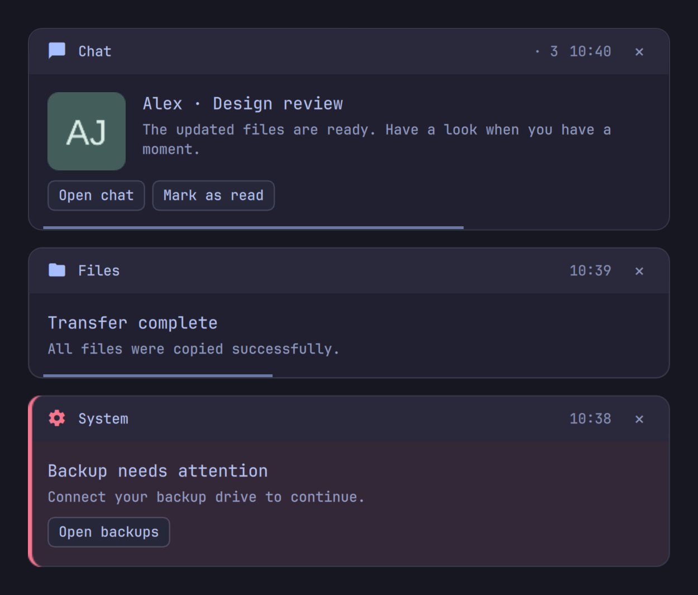

# Foamy Notifications

Compact notification popups for Omarchy Quattro, styled to match
[Foamy Notification Center](https://github.com/foamrider/foamy-notification-center).



## Install

Requires Omarchy Quattro, Quickshell, Python 3, and the standard Omarchy tools
(including `hyprctl` and `omarchy-shell`). Notification Center is optional.
File-backed app icons and sender pictures also need `file` and ImageMagick 7
(`magick`). Missing conversion tools keep the text, actions and icon fallback.

Sender files are converted outside the shell to PNGs of at most 720 × 720 pixels,
with the same decoder policy as Notification Center: no delegates or disk pixel
cache, 128 MiB pixel cache, a 512 MiB process-memory limit and a five-second
deadline. Input and output are limited to 5 MiB. Failed conversions never expose
the original image to Qt. Existing popup images are normalized before restoration.

Quickshell removes raw `image-data` buffers before plugins can validate them.
The popup therefore never renders its raw-image provider and immediately releases
native notifications carrying it, including raw-image replacements. For these
notifications, only bounded primitive snapshots enter monitor-context and
persistence queues. Text, website
favicons, named app icons and the normal app-focus fallback remain available.
A local `image-path` or file app icon can still be converted, but the sender may
delete that file when notified of closure; unavailable files use the icon fallback.
No network image retrieval is used.

This release ends sender callbacks and further in-place updates for raw-image
notifications. For example, a chat avatar sent as raw pixels means buttons such
as Reply or Mark read disappear, and clicking focuses the app rather than
invoking its notification-specific action. A raw image combined with a local-file
hint has the same tradeoff because Quickshell still holds the raw buffer. File-only
images, named theme icons and text-only notifications keep their live callbacks
and replacement behavior. Structured Omarchy command hints remain independent of
sender callbacks. The plugin cannot prevent Quickshell's initial buffer allocation;
it prevents those buffers accumulating in retained popup or history callbacks.

Sender metadata is checked before tracking notifications or queuing snapshots:
app names are limited to 256 characters, app icons/local paths to 4096, titles to
4096, bodies to 16384, desktop entries to 512, glyphs to 64, and command hints to
8192. Encoded image URLs may use up to 12288 characters. At most 32 incoming
actions are accepted, with identifiers limited to 256 characters and labels to
512. Oversized notifications or updates are rejected rather than truncating a
path, action identifier or command. A rejected update releases its live callback;
the previous popup text remains available.

Persistence packets are limited to 128 KiB of UTF-8 before entering the queue.
Pending work is limited to 128 jobs and 1 MiB of serialized payload/command data;
notification writes may use at most 64 jobs and 768 KiB, reserving the rest for
actions, reads and cleanup. There is only one running file job. The service tracks
at most 256 live notification sources, plus at most 100 briefly waiting for monitor
context. New work is rejected when a limit is reached, and the error is reported
through logs and `foamy.notifications state`. Rejected/cancelled DND writes release
their callbacks without retrying. Handling, replacement removal and history
clearing cancel obsolete pending writes; expiry still archives ordinary messages.
Normal delivery resumes as the backlog drains. These limits protect the plugin's
retained work; they do not change Quickshell's D-Bus implementation.

```sh
omarchy plugin add https://github.com/foamrider/foamy-notifications.git --enable
omarchy restart shell
```

Enabling the plugin replaces `omarchy.notifications`. Run only one notification
server. The existing Omarchy notification commands and do-not-disturb control
continue to work.

## Use

- Website favicons or app icons stay in a slim header; sender images appear beside the message.
- Hover to pause the timer. A smooth, optional line shows the remaining time.
- Left-click or use an action to handle a notification and remove it from history.
  Right-click hides the popup and keeps it in history. × does the same by default;
  enable **X removes from history** in the center's Foamy Notifications settings
  to remove the popup's whole duplicate group from history instead.
- Exact duplicates share a card. Overflow goes to history.
- Critical alerts have a colored edge and stay until dismissed by default.
  Enable **Do Not Disturb also silences critical alerts** in the center’s Foamy
  Notifications settings to send them directly to history during DND, including
  Omarchy crash alerts. The option is off by default; transient alerts are not stored.
- Cards fade in and out. While the pointer is inside the stack, expired cards
  leave their space in place so the hovered card does not move away.

Configure timeout, compact layout, images, monitor placement, fullscreen
suppression, and browser app matching in `shell.json`. See
[configuration and validation](CONFIGURATION.md) for all settings and checks.

Actions supplied by an app work while that app is connected, except for raw-image
notifications released as described above. Restored messages
cannot recover old app callbacks. Failed actions keep the notification available
for retry. The center retains its own history and optional image previews.

Notification Center can invoke a live default action through
`foamy.notifications invokeDefault <timestamp-id>`. The method returns `invoked`,
`unavailable`, `busy`, or `invalid`. It accepts only an exact current notification
key and handles that notification without clearing its whole duplicate group.
For a visible popup with its current tracked native identity, its structured
command runs with the same persist-before-launch ordering as a popup click.
Restored, detached, or archived command vectors are unavailable through this IPC. With the center enabled, live default actions remain
available after popup expiry, hiding, and DND silencing. At most `historyLimit`
(100) history callbacks remain tracked; older callbacks are released first.
Sender closure, successful handling, history dismissal/clearing, and disabling
the center release callbacks. Replacements update the retained history entry.
Browser or shell restarts cannot restore callbacks; unavailable actions still
use the center's fixed image opener or app-focus fallback. The center preserves
the standard Tensaku screenshot action as a fixed image-editing intent through
expiry and reload.

After durable history removal, the center calls `releaseHistory <keysCsv>`
(up to 100 exact keys), or `releaseHistoryBefore <timestamp>` after clearing.
The cutoff preserves notifications received after the clear request. Cleanup
also covers visible popups and silenced notifications still being written.
These cleanup calls are optional when using stock or older notifications.

## Remove

```sh
omarchy plugin remove foamy.notifications
omarchy restart shell
```

Removing an enabled plugin restores stock notifications. If you disabled it
first, explicitly enable `omarchy.notifications`. History and do-not-disturb
state remain on disk. Omarchy manages the plugin entry in `shell.json`; packages
and data outside the plugin directory remain in place.

## License

[MIT](LICENSE), with [Omarchy attribution](LICENSE-OMARCHY).
The preview uses synthetic messages and an original sample avatar.

Provided **as is**, without warranty or guaranteed support. Use at your own risk.
